# Esri Spatial Data Science MOOC, rebuilt in ArcPy

Four of the five sections of Esri's MOOC *Spatial Data Science: The New Frontier in Analytics* (Fall 2026), redone as ArcPy scripts against the course's own exercise data in ArcGIS Pro 3.7. The MOOC teaches each step by clicking through Pro; this repo makes every step reproducible, keeps every tool's messages, and adds the checks the course leaves out.

## Key findings

All numbers come from `results/*.json|csv`, written by the scripts in `src/`. Random draws (forest validation splits, permutations) are seeded through `arcpy.env.randomGenerator`, so a rerun gives the same numbers.

- **The course's validation overstates how well its turnout model transfers.** The refined forest-based regression scores a mean validation R² of **0.76** on the course's random 10 % hold-outs. Holding out whole states instead (leave-one-state-out) drops it to **0.58** pooled, and to **−0.48 for Iowa**, the one state the course then downscales to. Neighbouring counties share state law, a regional economy and the statewide margin, so a random split tests interpolation, not transfer.
- **The neighbourhood definition decides the hot-spot map.** With the tool's default fixed distance band (146 km, set by the sparsest county in the West, mean 37 neighbours) Gi* marks **1,912 of 3,105** counties as significant SNAP hot or cold spots; with polygon contiguity (mean 6 neighbours) it marks **759**. The two never disagree on direction, but the default smooths the local pattern over whole regions.
- **The course numbers reproduce.** Join counts (3,115 and 3,112 matches), the one Louisiana null, and the three suitability submodels whose weights are stored in the course's `.sam` file (two ranges match exactly, the third to within 0.12) all come out as the course says, which is the check that the rebuild is faithful before the extra analyses are added.

| Section | Topic | Data | Status |
|---|---|---|---|
| 1 | Data engineering and visualization: county voter turnout 2008–2020 | MIT Election Lab county returns, Census CVAP | done |
| 2 | Prediction: forest-based regression of turnout, downscaled to tracts | Esri-enriched county and tract layers (Iowa and neighbours) | done |
| 3 | Suitability: siting a carbon-neutral headquarters in Vermont | Vermont rasters and features, course Suitability Modeler file | done (three of four submodels use the course's exact functions and weights; the rest are stated assumptions) |
| 4 | Pattern detection and space-time mining: SNAP participation 2010–2019 | 3,105 counties × 10 years | done |
| 5 | Deep learning (object detection) | not downloaded | out of scope: separate data download and GPU training time |

## Skills shown

- **ArcPy** end to end: geoprocessing, `arcpy.da` cursors, `arcpy.mp` layouts built headlessly, tool-message parsing, seeded random generators.
- **Spatial Statistics**: Hot Spot Analysis (Gi*), Cluster and Outlier Analysis (Local Moran's I), FDR correction, neighbourhood conceptualizations.
- **Spatial Analyst**: Surface Parameters, Distance Accumulation with barriers, Rescale by Function, Reclassify, map algebra, Locate Regions; the Suitability Modeler rebuilt from its saved `.sam` file.
- **Space-time cubes**: Create Space Time Cube From Defined Locations, Emerging Hot Spot Analysis, Local Outlier Analysis.
- **Forest-based regression**: Forest-based and Boosted Classification and Regression, repeated validation, variable importance, distance features, prediction to other features with variable matching, range diagnostics.
- **Spatial cross-validation**: leave-one-state-out blocking written on top of the Esri tool, compared with the random hold-out.
- Data engineering and QA: Validate Join, null diagnosis, reimplementing a course script tool null-safe, matplotlib figures from `arcpy.da`.

## Section 1 — Data engineering

**What the course asks.** Join citizen voting-age population (CVAP) to county presidential returns, explain the records that fail to join, derive per-year fields (major-party votes, margins, turnout, winner), validate turnout, and join the table to county geometry.

**Method** (`src/s1_data_engineering.py`): Validate Join → Join Field on `FIPS_txt` ← `FIPS`; null diagnosis by state; Delete Rows for Alaska; a null-safe reimplementation of the course's "Multi-Year Calculate Field" script tool; cap turnout at 1; Join Field onto `US_Counties`.

**Results** (`results/s1_data_quality.csv`):

| Check | Value | Course said |
|---|---|---|
| Election rows / CVAP rows | 3,153 / 3,225 | |
| Validate Join matches (FIPS_txt ← FIPS) | **3,115** | 3,115 |
| Rows with no CVAP match | 38, **all Alaska** | Alaska |
| Alaska rows removed | 41 (38 unmatched + 3 districts whose FIPS happen to equal a borough code) | |
| Remaining null | LaSalle Parish, LA (22059): no 2008 CVAP, so 2008 turnout is null | "one Louisiana record" |
| Turnout > 1, capped to 1 | **6 (2008), 2 (2012), 4 (2016), 13 (2020)**: 25 county-years | |
| County polygons matched | **3,112 of 3,112** | 3,112 |

Alaska fails because its returns are reported by state legislative district (`02001`, `02002`, …), not by borough, so there is nothing to join CVAP to. Turnout exceeds 1 because CVAP is a 5-year American Community Survey average while votes are counted on one day; in the capped counties (Loving TX, 40 CVAP; Kenedy TX, 90; Daggett UT, 375 …) sampling error and population change easily exceed the gap. Capping is the course's choice: dropping them would leave holes in the map, keeping them would put impossible values into the models.

Turnout by year after cleaning (`results/s1_turnout_summary_by_year.csv`): mean 0.607 (2008), 0.581 (2012), 0.591 (2016), **0.659 (2020)**.

## Section 1 — Visualization

**What the course asks.** Explore the enriched 2020 layer with a histogram, a standard-deviation choropleth, a box plot by state and a scatterplot matrix.

**Method** (`src/s1_visualization.py`): matplotlib figures from the attribute table and geometries read with `arcpy.da`, plus one real Pro layout built headlessly with `arcpy.mp` (`createMap`, `GraduatedColorsRenderer` with `StandardDeviation`, `createLayout`, `createMapFrame`, legend, `exportToPNG`).

**Results.** 2020 turnout across 3,112 counties: mean 0.659, median 0.660, SD 0.097, skewness +0.10 (close to normal). Per-capita income is right-skewed (1.49), population density extremely so (26.6), which is why the course log-transforms density. Lowest-turnout states by county median: Arkansas 0.533, Oklahoma 0.550, West Virginia 0.561; highest: Colorado 0.786, Washington 0.757, Oregon 0.753. Turnout vs per-capita income R² = **0.320**, vs bachelor's share 0.215, vs median age 0.201 (`results/s1_scatter_r2.csv`).

| Standard-deviation choropleth (1 SD classes) | ArcGIS Pro layout via arcpy.mp |
|---|---|
| 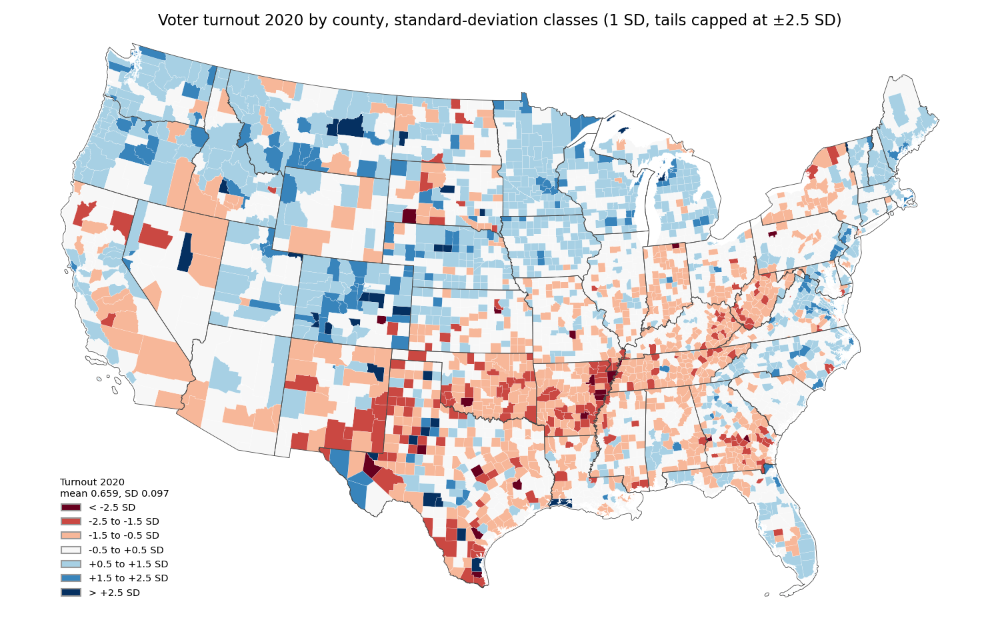 | 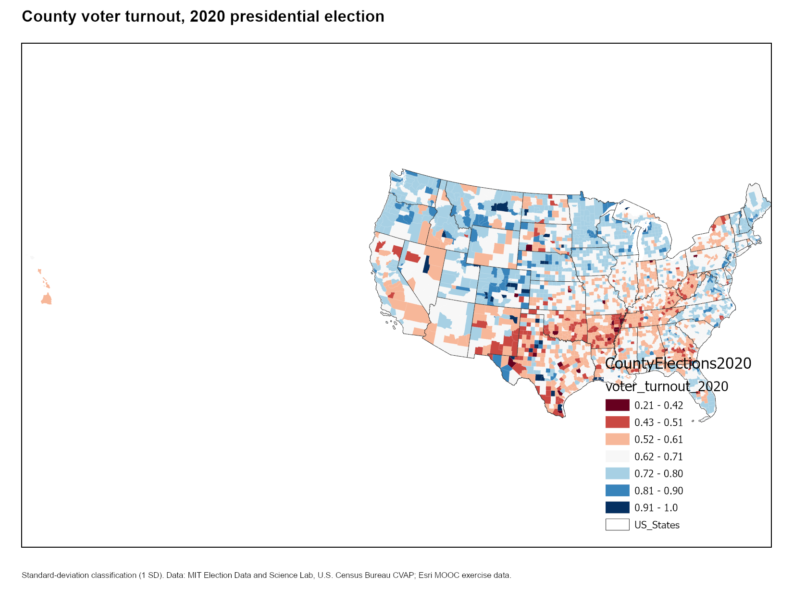 |

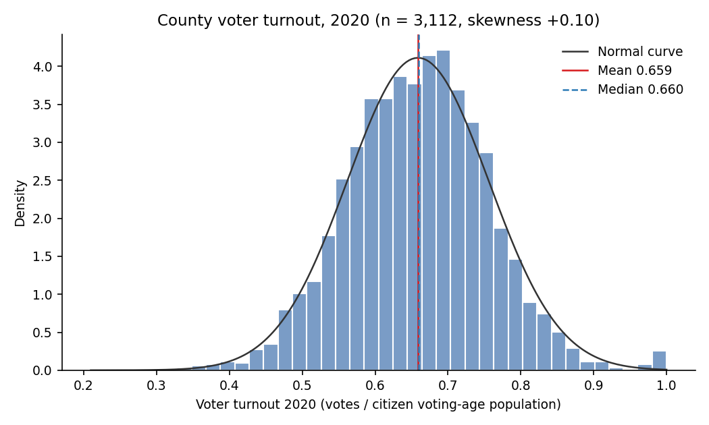
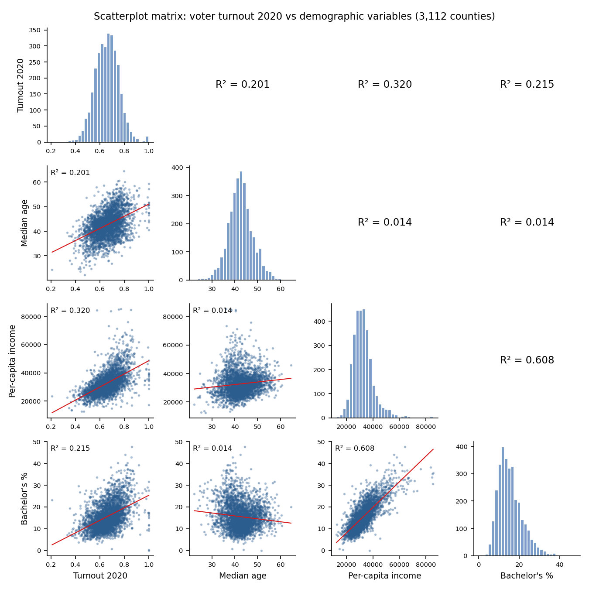

## Section 2 — Prediction

**What the course asks.** Predict county voter turnout with *Forest-based and Boosted Classification and Regression*, improve the model step by step (baseline variables → many variables → distance to cities → a refined set chosen by variable importance), then predict the refined model onto census tracts.

**Method** (`src/s2_prediction.py`): training layer `CountyElections_IA_and_Neighbors` (739 counties in IA, IL, KS, MN, MO, NE, SD, WI; 2016 turnout), 100 trees, **10 validation runs** with a random 10 % hold-out each, `voter_laws` as a categorical variable, `Cities5`…`Cities10` as distance features, refinement = keep variables with ≥ 3 % of total mean importance. Prediction to `Tracts_Iowa` (824 tracts) with explanatory-variable matching. One extra pair of models on the national `CountyElections2020` layer (3,112 counties, 2020 turnout).

**Results** (`results/s2_model_comparison.csv`):

| Model | Variables | Validation R², mean of 10 runs (min–max) | OOB % variance explained |
|---|---|---|---|
| M1 baseline (median age, per-capita income, bachelor's %) | 3 | 0.50 (0.40–0.67) | 41.1 |
| M2 many variables | 22 | 0.77 (0.70–0.85) | 66.7 |
| M3 many + distance to cities | 22 + 6 | **0.77 (0.67–0.87)** | 66.8 |
| M4 refined (importance ≥ 3 %) | 12 + 1 (Cities5) | 0.76 (0.70–0.84) | 67.8 |
| National 2020, baseline | 3 | 0.49 (0.45–0.53) | 44.2 |
| National 2020, 16 variables | 16 | 0.65 (0.61–0.68) | 60.4 |

The refined model keeps per-capita income (highest importance), share without a high-school diploma, poverty, median age, the statewide margin (`state_votes_pcnt_diff`), never-married share, GED share, population 18+ and 65–69, the diversity index, savings, a psychographic variable and distance to the largest cities (`Cities5`); the full table is `results/s2_variable_importance.csv`. The min–max spread across the 10 runs is wide (0.14–0.20 R² for M2–M4): a single validation split would have been misleading either way.

**Downscaling.** Predicted tract turnout in Iowa ranges 0.42–0.76 (mean 0.648; `results/s2_prediction.json`). The tool's *Explanatory Variable Range Diagnostics* flag **10 of 13 variables** as extrapolating (`+`: the tract values reach outside the county training range; e.g. per-capita income spans $5,132–$67,796 in tracts vs $9,395–$46,933 in counties). Tract predictions in those ranges are extrapolations of a tree model, which can only repeat the nearest training leaf. `results/s2_range_diagnostics.csv` has every row.

**Extra: spatially blocked validation.** A random 10 % hold-out leaves every held-out county surrounded by training counties, and neighbouring counties share what the model learns (state law, regional economy, the statewide margin, which is constant within a state). Holding out whole states instead (`leave_one_state_out()`, same refined variable set, same settings):

| Validation | R² |
|---|---|
| Random 10 % hold-out, mean of 10 runs | **0.76** |
| Leave-one-state-out, pooled over all 739 counties | **0.58** |
| Leave-one-state-out, mean of the 8 per-state R² | 0.33 |
| Per state | IL 0.46, IA −0.48, KS 0.25, MN 0.29, MO 0.37, NE 0.58, SD 0.61, WI 0.56 |

Iowa is the worst case (negative R²: the model predicts a lower mean, 0.63 vs 0.67 observed, and none of the within-state structure), which is awkward because Iowa is exactly the state the course downscales to. Within-state R² falls because the model's biggest single signal, the statewide margin, cannot separate counties inside one state.

| Validation R² by model | Spatially blocked check |
|---|---|
| 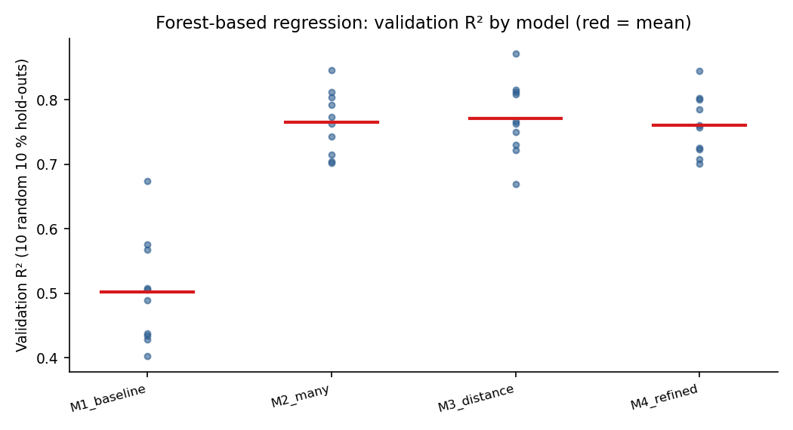 | 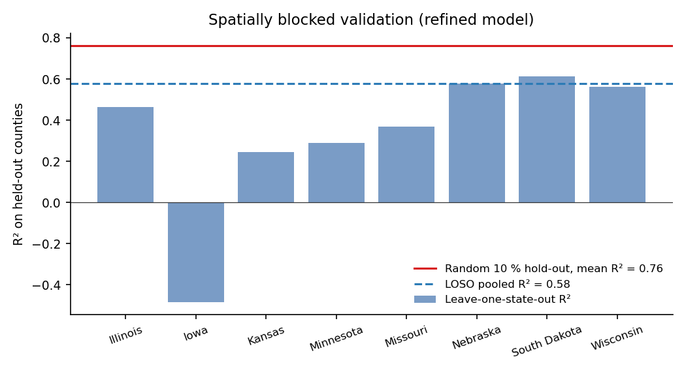 |

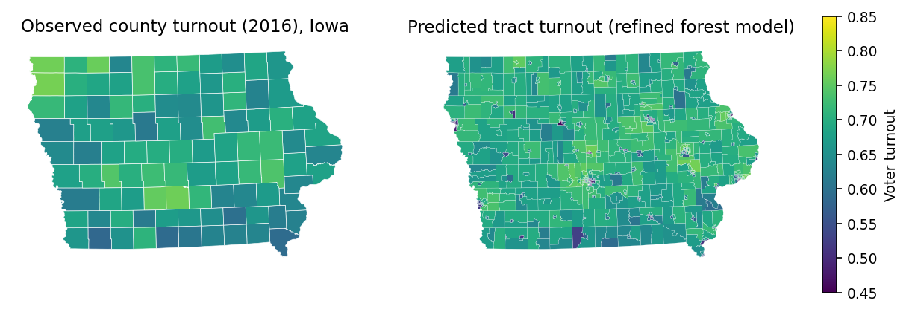

## Section 3 — Suitability

**What the course asks.** Find the best site for a carbon-neutral headquarters in a Vermont study area with the Suitability Modeler: derive slope and distance to major roads (with the Green Mountain ridge as a barrier), transform each criterion to a 1–10 scale, weight criteria inside four submodels (building site, energy independence, access to amenities, environmental concerns), combine, and locate the best region.

**Method** (`src/s3_suitability.py`): `SurfaceParameters` (slope, degrees, quadratic), `DistanceAccumulation` with `GreenMTRidge` as `in_barrier_data`, `RescaleByFunction` with the `Tf*` transformation classes, `Reclassify` for land use, weighted `Times`/`Plus` algebra, `LocateRegions`. Environment: 30 m cells snapped to `Elevation_30`, `Study_Mask` as the mask.

**Which values are the course's.** `Suitability.sam` (the course's saved Suitability Modeler file) stores three submodels in full, and `read_sam()` uses them verbatim:

| Submodel | Criterion: function (weight) |
|---|---|
| Environmental concerns | Dist_Protect: LogisticGrowth (1.6); Dist_Biol: MSLarge (1.5); Dist_Wetlands: Linear (1.4); Dist_Streams: Large, midpoint 3,486 m (1.2) |
| Access to amenities | Dist_Airport: Small, midpoint 22,097 m (1.0); Dist_Rec: MSSmall (1.0); Dist_Resident: Linear inverted (1.35) |
| Energy independence | Aspect: Gaussian, midpoint 179.5° (1.35); Dist_Elect: Small, midpoint 5,749 m (1.7); Solar: Large, midpoint 442,742 (1.8) |

The check that the rebuild is faithful: the weighted sums reproduce the ranges of the course's own output rasters in `Headquarters_Siting.gdb` (`results/s3_submodel_ranges.csv`): Environmental 5.70–37.00 vs course 5.70–37.00; Energy 4.95–48.16 vs 4.95–48.16; Amenities 5.74–33.50 vs 5.62–33.50 (the minimum differs slightly, most likely a mask/extent difference).

The **building-site submodel** is not in the .sam, so its values are mine and are marked `assumption` in `results/s3_criteria.csv`: land-use lookup (developed and open land 7–10, forest 3, wetlands and water 1), slope MSSmall, distance to major roads Small, and visibility from roads with **LogisticDecay**, the function the course specifies: the more visible a site is from the roads, the less preferred it is, so suitability falls as visibility rises (tool-default 99 % intercept). All four are weighted 1.0. The final model rescales each submodel linearly to 1–10 and averages them with equal weights (assumption), and Locate Regions asks for one circular 2 km² region by highest average value (the .sam only holds the dialog default of 338.56 km², which is 10 % of the extent and not a plausible site).

**Results** (`results/s3_suitability.json`): final surface 2.21–8.64 (mean 5.61). The best 2 km² region is at 44.566° N, 73.064° W (Chittenden County, north-east of Burlington), mean suitability 7.71, with submodel means Building site 8.43, Energy 7.75, Amenities 7.69, Environment 6.96. One course choice stands out in the criteria grid: with midpoints at half the data range, the *Large* functions on distance to streams and protected areas score nearly the whole study area 1–3, so those two criteria mostly act as a penalty on the few far-away cells.

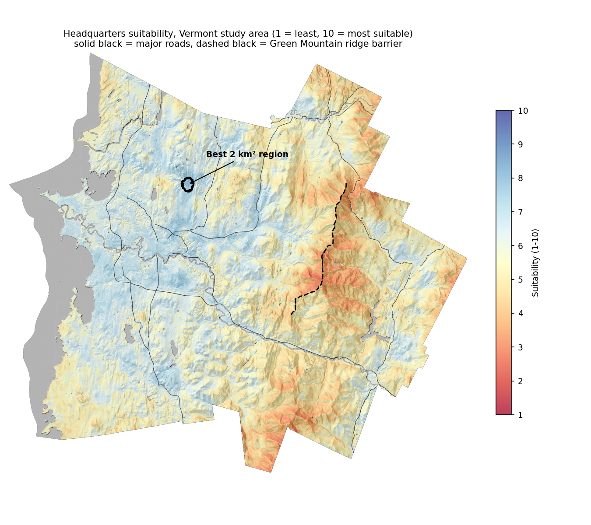
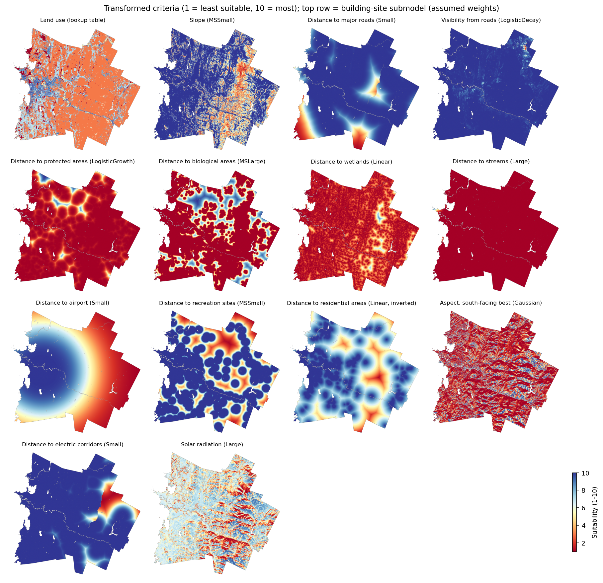

More: `figures/s3_submodels.png`, `figures/s3_distance_barrier.png` (what the ridge barrier changes).

## Section 4 — Pattern detection and space-time

**What the course asks.** Hot Spot Analysis (Gi*) of county SNAP participation, Cluster and Outlier Analysis (Local Moran's I), a space-time cube of 2010–2019 rates, Emerging Hot Spot Analysis and Local Outlier Analysis.

**Method** (`src/s4_patterns_spacetime.py`): 3,105 contiguous-US counties, field `SNAPRate_1` (2019 rate). Gi* run twice: with the tool's default fixed distance band, then with polygon contiguity (edges and corners). Local Moran's I with contiguity and 999 permutations. Cube from defined locations (`CountyID`, related table `SNAP_County_Rates2010_2019`, 1-year steps, 10 steps, 0 % estimated bins; the cube's overall trend is decreasing, Mann-Kendall z = −3.22, p = 0.001). EHSA and Local Outlier Analysis (499 permutations) with contiguity and a 1-step time neighbourhood. **FDR** correction is applied in the two Gi* runs and in Local Moran's I; the two space-time tools do not offer it in Pro 3.7, so none is applied there.

**Results.** The default distance band is **145,772 m** (the tool's "ensure every feature has at least one neighbour" rule, driven by the largest western counties), which gives a **mean of 37.4 neighbours** (1–84). Contiguity gives a mean of **5.95** (1–14).

| Gi* class (FDR) | Fixed band, 146 km | Contiguity |
|---|---|---|
| Hot spot (90/95/99 %) | 898 (77 / 132 / 689) | 406 (77 / 125 / 204) |
| Not significant | 1,193 | 2,346 |
| Cold spot (90/95/99 %) | 1,014 (127 / 202 / 685) | 353 (141 / 192 / 20) |

The two agree on direction wherever both are significant (no county is hot in one and cold in the other), but the 146 km band pulls 1,153 more counties into significance: with 37 neighbours the local mean is smoothed over whole regions (the entire South, Appalachia, New Mexico; the Upper Midwest and Mountain West as cold). Contiguity keeps the pattern local: the Mississippi Delta, eastern Kentucky, southern New Mexico and the Rio Grande counties as hot spots. Local Moran's I (contiguity, FDR; `results/s4_lisa_counts.csv`): 281 High-High, 392 Low-Low, 15 High-Low and 17 Low-High counties.

Space-time: EHSA finds hot or cold spot trends in 1,242 of 3,105 counties. Cold-spot categories dominate (580 Consecutive, 180 Intensifying, 97 New, 68 Sporadic, 26 Persistent, 1 Diminishing), consistent with SNAP participation falling over the decade; hot spots are mostly **Diminishing (145)** or **Persistent (101)** (the Delta, Appalachia, New Mexico, the Rio Grande), with 27 Consecutive, 12 Intensifying and 5 Sporadic. Local Outlier Analysis: 725 counties were only ever High-High clusters, 1,107 only Low-Low, 40 High-Low, 60 Low-High, 92 of several types, 1,081 never significant.

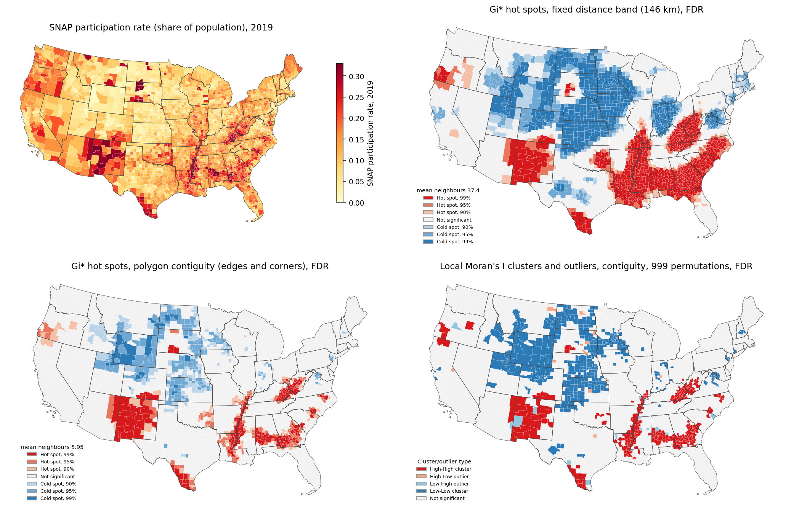
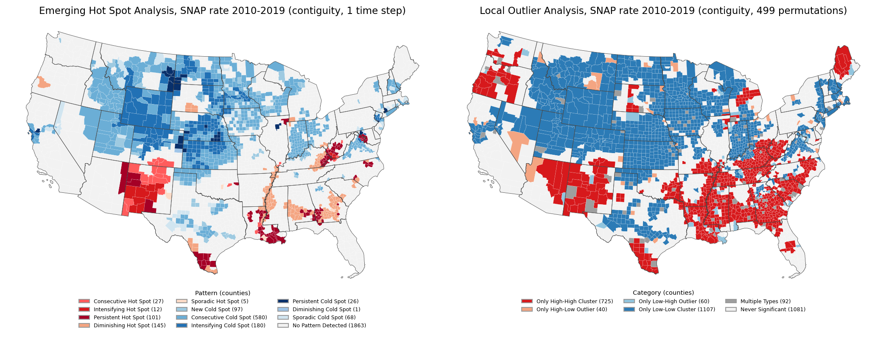

## Caveats, and what I would do differently

- **Spatial cross-validation should be the default.** The course's validation (random hold-out, repeated) answers "how well does the model interpolate between neighbours", not "how well does it transfer". Leave-one-state-out drops R² from 0.76 to 0.58 pooled and to negative in Iowa. A model meant to downscale to Iowa tracts should be validated by holding Iowa out.
- **Downscaling is extrapolation.** Ten of thirteen explanatory variables take values in tracts that no county reaches. The tool says so in its range diagnostics; the course does not dwell on it.
- **MAUP.** Every result here is a county result. Turnout, SNAP rates and hot spots would change with different units (the Alaska districts are the extreme case: the units do not even match). Tract-level predictions from a county model add the ecological-inference problem on top.
- **5-year CVAP vs one election day.** Turnout denominators are a 5-year survey average centred roughly two years before the election; in small counties the resulting error can exceed 10 % (25 county-years go above 1). Capping at 1 is a repair, not a fix; a vintage-matched population estimate would be better.
- **Neighbourhood choice drives Gi*.** The default distance band is set by the sparsest county in the West, which over-smooths the East. For polygons of very different sizes, contiguity or a k-nearest-neighbours definition is more defensible than one distance.
- **No FDR in the space-time tools**, so the EHSA/LOA counts are the uncorrected versions of 3,105 (× 10) tests and are optimistic.
- **Suitability weights are opinions.** Only three of the four submodels have the course's weights; the building-site weights, the land-use lookup and the equal-weight final combination are mine. A sensitivity run (vary each weight ±50 %, see whether the best region moves) is the natural next step and is easy with these scripts.
- **The 2 km² region** is my choice of size; a real siting brief would specify the footprint.
- **Two course steps are not scripted.** Section 5 (deep learning) is not reproduced, and the cube is not visualized in 3D (that is a Pro view, not a tool).

## Run it

Requires ArcGIS Pro 3.7 (Advanced) with Spatial Analyst, and the course's exercise data (download from the MOOC, unzip, and copy the four folders into `data/`: `DataEngineering_and_Visualization`, `Prediction`, `Suitability`, `PatternDetection_SpaceTime`). No ArcGIS Online credits are used (the enriched layers are the ones the course ships).

```
"C:\Program Files\ArcGIS\Pro\bin\Python\envs\arcgispro-py3\python.exe" run_all.py        # all four sections, ~15 min
"C:\Program Files\ArcGIS\Pro\bin\Python\envs\arcgispro-py3\python.exe" run_all.py s4     # one section
"C:\Program Files\ArcGIS\Pro\bin\Python\envs\arcgispro-py3\python.exe" src/s3_suitability.py --figures-only   # redraw figures from existing outputs (s2, s3, s4)
```

Outputs: `outputs/*.gdb` and the space-time cube (ignored by git), `outputs/logs/` (every tool's messages), `results/` (metrics as CSV/JSON), `figures/` (PNG). `COURSE_NOTES.md` maps each script function to the MOOC exercise steps.

Code layout: `src/common.py` (paths, ArcPy helpers, polygon reading for matplotlib, SD class breaks), `src/s1_data_engineering.py`, `src/s1_visualization.py`, `src/s2_prediction.py`, `src/s3_suitability.py`, `src/s4_patterns_spacetime.py`, `run_all.py`.

## Data and licenses

Exercise data © Esri, from the Esri MOOC *Spatial Data Science: The New Frontier in Analytics*, licensed for training and educational use only and **not redistributed here** (`data/` is ignored). Within it:

- County presidential returns 2000–2020: MIT Election Data and Science Lab, *County Presidential Election Returns 2000-2020*, Harvard Dataverse, doi:10.7910/DVN/VOQCHQ (CC0 1.0).
- Citizen voting-age population: U.S. Census Bureau, American Community Survey 5-year CVAP special tabulations (2006–2010, 2010–2014, 2014–2018, 2017–2021).
- Demographic enrichment variables on the county and tract layers (median age, income, education, Tapestry/psychographic percentages): Esri Demographics 2019, as attached by the course.
- County and state boundaries: Esri / U.S. Census Bureau, as shipped in the course geodatabases.
- SNAP participation 2010–2019: county participants and rates as provided in the course geodatabase (the course credits USDA Food and Nutrition Service data with Census population estimates; the original source file is not included).
- Vermont suitability layers (elevation, land cover, roads, streams, wetlands, protected and biological areas, electric corridors, recreation sites, Burlington airport): Vermont Open Geodata Portal / NLCD, as packaged by Esri for the course.

Code: MIT License © 2026 Landon Melesky (see `LICENSE`). The license covers the code, figures and metric tables only; the Esri exercise data keep Esri's terms.

## References

- Esri. *Spatial Data Science: The New Frontier in Analytics* (MOOC). https://www.esri.com/training/catalog/5d76dcf7e9ccda09bef61294/spatial-data-science%3A-the-new-frontier-in-analytics/
- Esri. How Forest-based and Boosted Classification and Regression works; How Hot Spot Analysis (Getis-Ord Gi*) works; How Emerging Hot Spot Analysis works; Rescale by Function. ArcGIS Pro 3.7 tool reference.
- Breiman, L. (2001). Random forests. *Machine Learning*, 45(1), 5–32.
- Getis, A., & Ord, J. K. (1992). The analysis of spatial association by use of distance statistics. *Geographical Analysis*, 24(3), 189–206.
- Anselin, L. (1995). Local indicators of spatial association—LISA. *Geographical Analysis*, 27(2), 93–115.
- Benjamini, Y., & Hochberg, Y. (1995). Controlling the false discovery rate. *Journal of the Royal Statistical Society B*, 57(1), 289–300.
- Roberts, D. R., et al. (2017). Cross-validation strategies for data with temporal, spatial, hierarchical, or phylogenetic structure. *Ecography*, 40(8), 913–929.
- Openshaw, S. (1984). *The Modifiable Areal Unit Problem*. CATMOG 38, Geo Books.
